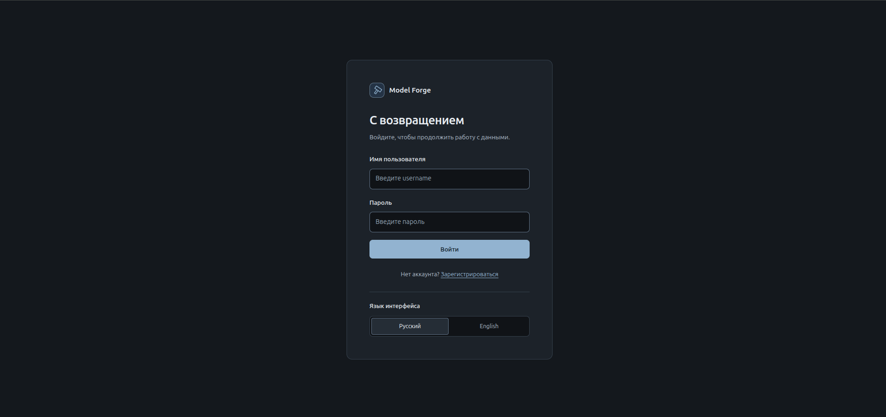
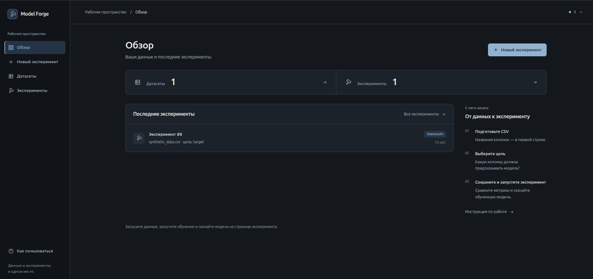
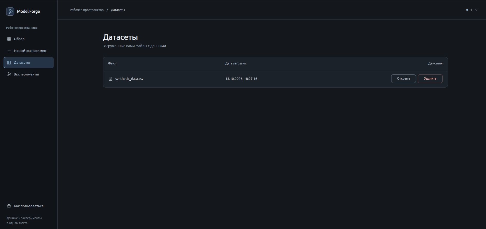
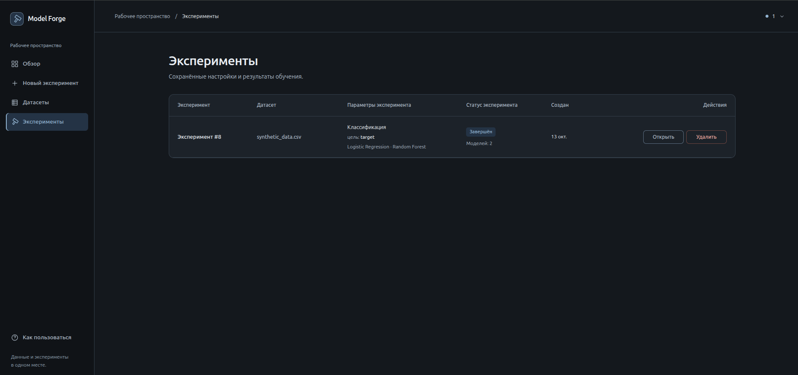
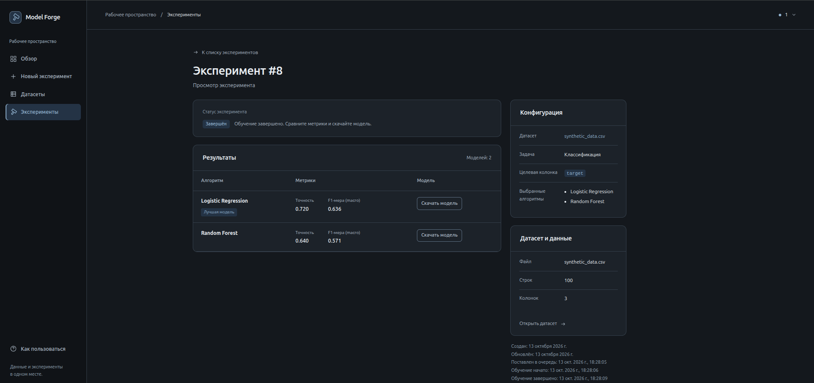

# Frontend Model Forge

[Документация проекта](README.md)

Frontend: React, TypeScript, Vite. Основные разделы — датасеты, эксперименты и результаты обучения. Данные загружаются из Django REST API.

## Запуск через Docker Compose

Из корня проекта:

```bash
docker compose -f local.docker-compose.yml up -d --build
```

Адрес: `http://localhost:5173`. Vite в контейнере перенаправляет запросы `/api` к сервису `backend`.

## Разработка без Docker

В Docker и CI используется Node.js 20. Установка зависимостей и запуск из каталога `frontend`:

```bash
npm ci
npm run dev
```

Backend запускается отдельно на `http://127.0.0.1:8000`. Адрес прокси задаётся переменной `VITE_API_PROXY_TARGET` в настройках Vite.

Проверки перед коммитом:

```bash
npm run lint
npm run build
```

`lint` запускает ESLint, `build` — проверку TypeScript и production-сборку. Собранные файлы раздаёт Nginx.

## Структура

| Путь | Содержание |
| --- | --- |
| `src/App.tsx` | Маршруты страниц |
| `src/pages/` | Страницы датасетов, экспериментов, входа и справки |
| `src/components/` | Общие элементы интерфейса |
| `src/services/` | Запросы к API и типы ответов |
| `src/hooks/` | Загрузка доступных алгоритмов |
| `src/utils/` | Язык, сообщения, тема и форматирование |
| `public/` | Статические файлы |

Клиент в `src/services/api.ts` использует базовый путь `/api` и заголовок `Authorization: Token ...`. Локальные запросы проксирует Vite, в production Compose — внешний Nginx. Для Kubernetes запланирована маршрутизация через Ingress.

Форма `/train` создаёт эксперименты классификации. Регрессия доступна через API. Экран редактирования меняет целевую колонку и алгоритмы; тип задачи доступен только для просмотра.

## Интерфейс приложения

Основной сценарий: вход → загрузка датасета → создание эксперимента → обучение → скачивание модели.

### Вход



### Главная страница



### Датасеты



### Эксперименты



### Результат эксперимента



Скриншоты: `docs/screenshots/`. Запросы и статусы экспериментов описаны в [API](api.md).
